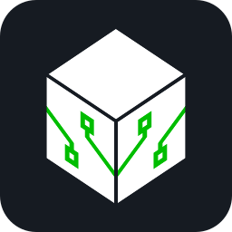
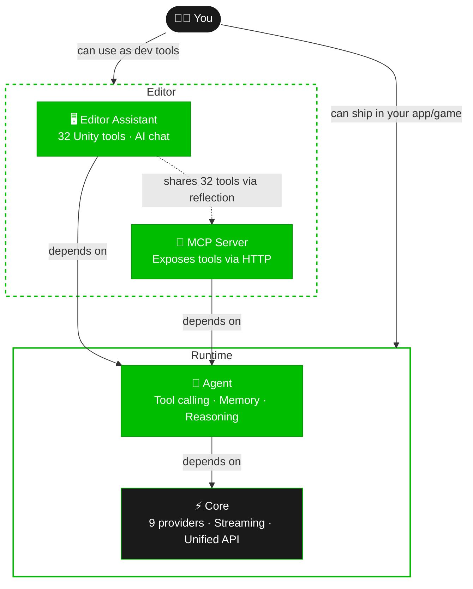

# UNAI - Universal AI Connector for Unity

<p align="center">
  
</p>

[](LICENSE)
[](https://unity.com)
[](https://github.com/experir/unai-unity-ai-connector/releases)
[](https://github.com/experir/unai-unity-ai-connector/stargazers)
[](https://github.com/experir/unai-unity-ai-connector/issues)
[](https://github.com/experir/unai-unity-ai-connector/pulls)
[](https://docs.microsoft.com/en-us/dotnet/csharp/)
[](#documentation)

Connect Unity to cloud and local AI models with a unified C# API. UNAI includes adapters for OpenAI, Anthropic, Google Gemini, Mistral, Cohere, Ollama, LM Studio, llama.cpp, and OpenAI-compatible chat APIs. Model and feature compatibility depends on the provider. Use cloud models or run local LLMs, and switch registered providers with one line of code.

**Start here:** [Installation](#installation) · [Quick Start](#quick-start) · [Provider configuration](Docs/providers.md) · [Troubleshooting](Docs/troubleshooting.md)

**One package, four ways to use AI in Unity:**

| Mode | What it does | Example |
|------|-------------|---------|
| **Runtime Chat** | Call any LLM from your game at runtime | NPC dialogue, AI mechanics, chatbots |
| **AI Agent** | Multi-step reasoning with tool calling and memory | Autonomous NPCs, game assistants |
| **Editor Assistant** | AI chat window inside the Unity Editor (32 tools) | Scene inspection, GameObject creation, script editing |
| **MCP Server** | Expose registered Unity tools over local HTTP | Connect an HTTP-capable MCP client; see [setup and limitations](Docs/mcp.md) |

All pure C#. No Node.js, no Python, no external processes, no separate frameworks.

## Architecture



> **Modular assemblies** — Editor Assistant and MCP discover each other via reflection. Both depend on Agent, and Agent depends on Core. When removing Agent, also remove its dependents and any imported agent samples. MCP needs Editor Assistant for the built-in editor tools. See [Modular Structure](#modular-structure).

## Why One Package Instead of Many?

Most Unity AI solutions force you to choose: a chat SDK for one provider, a separate agent framework, a separate MCP server, a separate editor tool — each with its own dependencies, update cycles, and integration issues.

**UNAI is different.** One package gives you everything:

- **Runtime + Editor + Agent + MCP** — all built on the same `IUnaiProvider` interface and `IUnaiTool` system
- **Reusable tools** — register the same `IUnaiTool` implementation with a runtime agent, the editor tool factory, or a custom MCP registry as appropriate
- **No dependency conflicts** — one package means one Newtonsoft JSON reference, one version to track, one update to apply
- **Separate assemblies** — keep only the modules you need together with their dependencies; see the module table below
- **No external server process** — the MCP server uses C# `HttpListener`, and the agent loop runs inside Unity. The package depends on Unity's Newtonsoft JSON package; the bundled examples also use Unity UI and TextMeshPro

## Supported Providers

| Provider | Type | Streaming | Auth |
|----------|------|-----------|------|
| **OpenAI** | Cloud | SSE | API Key |
| **Anthropic** | Cloud | SSE | API Key |
| **Google Gemini** | Cloud | SSE | API Key |
| **Mistral** | Cloud | SSE | API Key |
| **Cohere** | Cloud | SSE | API Key |
| **Ollama** | Local | NDJSON | None |
| **LM Studio** | Local | SSE | None |
| **llama.cpp** | Local | SSE | None |
| **Any OpenAI-compatible API** | Custom | SSE | Optional |

Set a model ID available to your account or local server; the editor's model suggestions are not a live catalog. OpenAI-compatible services can be configured through the custom adapter, but their endpoint paths, optional parameters and tool support need checking. See [Provider configuration](Docs/providers.md).

## Features

- **Unified API** — one interface for all providers, switch with a single line
- **AI Agent system** — multi-step reasoning with tool calling, conversation memory, and observe-think-act loop
- **Tool/Function calling** — native payloads for OpenAI-compatible adapters, Anthropic, Gemini and Ollama; text fallback for adapters without native support
- **MCP Server** — editor-only local HTTP endpoint exposing registered tools; see [protocol limitations](Docs/mcp.md#current-protocol-limitations)
- **Editor AI Assistant** — built-in editor window with 32 tools for scene inspection, GameObject creation, physics setup, asset management, and more
- **Structured output / JSON mode** — provider-specific JSON/schema options; Anthropic currently uses prompt instructions, and UNAI does not validate schemas locally
- **Conversation memory** — token-aware history management with automatic truncation
- **Real-time streaming** — token-by-token responses on the main thread, perfect for chat UIs
- **Async/await** — native C# `Task`-based API, no coroutine boilerplate
- **Runtime networking** — `UnityWebRequest` transport for desktop, mobile and WebGL; see [platform expectations](Docs/troubleshooting.md#platform-expectations)
- **Local AI support** — run models offline with Ollama, LM Studio, or llama.cpp
- **OpenAI-compatible** — shared Chat Completions adapter for compatible servers; feature support varies
- **Provider fallback chain** — automatic failover to backup providers when a request fails
- **Response caching** — LRU cache with TTL for non-streaming requests
- **Lazy provider init** — providers are instantiated on first use, not at startup
- **Package dependency** — Newtonsoft JSON (installed through Package Manager)
- **Runtime provider switching** — change AI backends on the fly without restarting
- **ScriptableObject config** — inspector setup and environment variable key overrides for trusted processes
- **Modular** — core, agent, editor assistant and MCP assemblies with explicit dependencies

## Use Cases

- **AI agents for games** — NPCs with tool use, memory, and multi-step reasoning
- **MCP bridge to Unity** — let Claude Desktop, Cursor, or any MCP client inspect and modify your Unity project
- **Editor AI assistant** — inspect scenes, create objects, set up physics, read scripts from a chat window
- **NPC dialogue** and AI-driven characters in games
- **In-editor AI tools** — coding assistants, content generation, automated scene setup
- **AI-powered game mechanics** — procedural quests, adaptive difficulty, dynamic storytelling
- **Chatbot and virtual assistant** apps built in Unity
- **Rapid prototyping** with local models (Ollama), deploying with cloud APIs (OpenAI, Claude)

## Installation

### Via Git URL (recommended)

In Unity, go to **Window > Package Manager > + > Add package from git URL** and enter:

```
https://github.com/experir/unai-unity-ai-connector.git
```

### Manual

Clone this repo into your project's `Packages` directory (e.g. `Packages/com.unai.universal-ai-connector`).

### Optional samples

Import samples from UNAI's Package Manager **Samples** section. **Minimal Runtime Chat** uses only Core. **Chat UI and Agents** requires Agent and `com.unity.ugui` 2.0.0 (Unity UI and TextMeshPro). Samples stay in `Samples~` until explicitly imported, so a clean package installation has no UI dependency.

### Installing Newtonsoft JSON

UNAI requires **Newtonsoft JSON** (`com.unity.nuget.newtonsoft-json`). It is usually installed automatically, but if you get compile errors about missing `Newtonsoft.Json`, install it manually:

1. Open **Window > Package Manager**
2. Click **+ > Add package by name**
3. Enter `com.unity.nuget.newtonsoft-json` and click **Add**

Alternatively, add it directly to your `Packages/manifest.json`:

```json
{
  "dependencies": {
    "com.unity.nuget.newtonsoft-json": "3.2.2"
  }
}
```

## Quick Start

### 1. Create a config

Open **Window > UnAI > Hub** and click **Core — Setup Wizard**, or go directly to **Window > UnAI > Setup Wizard**.

### 2. Set your API keys

Option A: Set environment variables for your development machine or a trusted server process, then restart Unity so it inherits them:
```
OPENAI_API_KEY=sk-...
ANTHROPIC_API_KEY=sk-ant-...
GEMINI_API_KEY=AI...
```

Option B: Paste keys directly in the inspector (for development only).

**Shipping a game:** keep shared cloud-provider keys on a backend you control. Environment variables do not make secrets safe in distributed desktop, mobile or WebGL clients. Choose a model available to your account; start with no optional request settings.

### 3. Add UnaiManager to your scene

Add the `UnaiManager` component to any GameObject and assign your config asset.

### 4. Use it

```csharp
using UnAI.Core;
using UnAI.Models;

// Run inside an async method on Unity's main thread, after the manager's Awake.
string reply = await UnaiManager.Instance.QuickChatAsync("What is Unity?");

// Full request with options
var request = new UnaiChatRequest
{
    Messages = new()
    {
        UnaiChatMessage.System("You are a game design assistant."),
        UnaiChatMessage.User("Give me 3 ideas for a puzzle mechanic.")
    }
};
var response = await UnaiManager.Instance.ChatAsync(request);
Debug.Log(response.Content);
```

`Debug` requires `using UnityEngine;`. Non-streaming provider errors throw `UnaiRequestException`; cancellation throws `OperationCanceledException`. See [error handling](Docs/troubleshooting.md#cancellation-and-error-handling).

### Streaming

```csharp
await UnaiManager.Instance.ChatStreamAsync(request,
    onDelta: delta =>
    {
        // Update UI in real-time (runs on main thread)
        myText.text = delta.AccumulatedContent;
    },
    onComplete: response => Debug.Log("Done!"),
    onError: error => Debug.LogError(error.Message)
);
```

### Switch providers at runtime

```csharp
UnaiManager.Instance.SetActiveProvider("ollama");   // local model
UnaiManager.Instance.SetActiveProvider("anthropic"); // cloud
UnaiManager.Instance.SetActiveProvider("openai");    // cloud
```

### Use a specific provider directly

```csharp
var claude = UnaiProviderRegistry.Get("anthropic");
var response = await claude.ChatAsync(new UnaiChatRequest
{
    Messages = new() { UnaiChatMessage.User("Hello Claude!") }
});
```

### Cancel a request

```csharp
// Inside an async method. Import System.Threading.
using var cts = new CancellationTokenSource(System.TimeSpan.FromSeconds(30));
await UnaiManager.Instance.ChatStreamAsync(
    request,
    onDelta: delta => Debug.Log(delta.AccumulatedContent),
    onError: error => Debug.LogError(error.Message),
    ct: cts.Token);
```

Catch `OperationCanceledException` in the caller. Each operation snapshots its request; later provider resolution does not mutate the caller. Backups use their own default models.

## AI Agent System

The agent system adds multi-step reasoning with tool calling and conversation memory on top of the chat API.

### Agent with custom tools

```csharp
using UnAI.Agent;
using UnAI.Tools;

// Create tools
var tools = new UnaiToolRegistry();
tools.Register(new MyWeatherTool());   // implements IUnaiTool; example below

// Create and run agent
var agent = new UnaiAgent(new UnaiAgentConfig
{
    SystemPrompt = "You are a helpful game assistant.",
    ProviderId = "anthropic", // must be initialized and enabled
    MaxSteps = 5,
    UseStreaming = true
}, tools);

agent.OnToolCall += args => Debug.Log($"Calling: {args.ToolCall.ToolName}");
agent.OnToolResult += args => Debug.Log($"Result: {args.Result.Content}");

var result = await agent.RunAsync("What's the weather in the player's city?");
Debug.Log(result.Response.Content);

// Continue the conversation (keeps memory)
var followUp = await agent.ContinueAsync("What about tomorrow?");
```

### Implementing a custom tool

```csharp
using System.Threading;
using System.Threading.Tasks;
using UnAI.Tools;
using Newtonsoft.Json.Linq;

public class MyWeatherTool : IUnaiTool
{
    public UnaiToolDefinition Definition => new()
    {
        Name = "get_weather",
        Description = "Get current weather for a city.",
        ParametersSchema = JObject.Parse(@"{
            ""type"": ""object"",
            ""properties"": {
                ""city"": { ""type"": ""string"", ""description"": ""City name"" }
            },
            ""required"": [""city""]
        }")
    };

    public Task<UnaiToolResult> ExecuteAsync(UnaiToolCall call, CancellationToken ct)
    {
        ct.ThrowIfCancellationRequested();
        var args = call.GetArguments();
        string city = args["city"].ToString();
        // Demo data only. Replace this with your weather service.
        return Task.FromResult(new UnaiToolResult { Content = $"Demo weather: sunny, 22C in {city}" });
    }
}
```

### Conversation memory (standalone)

```csharp
using UnAI.Memory;

var conversation = new UnaiConversation { SystemPrompt = "You are an NPC shopkeeper." };
conversation.AddUser("What do you sell?");

// Build request with automatic token-aware truncation
var request = conversation.BuildRequest(maxContextTokens: 4096);
var response = await UnaiManager.Instance.ChatAsync(request);

conversation.AddAssistant(response.Content);
// Conversation remembers full history, truncates oldest when needed
```

## Editor AI Assistant

Open **Window > UnAI > AI Assistant** to get a chat-powered assistant directly in the Unity Editor.

### Built-in tools (32)

| Category | Tools |
|----------|-------|
| **Scene** | `inspect_scene`, `find_gameobject`, `get_selection`, `focus_scene_view` |
| **GameObjects** | `create_gameobject`, `modify_gameobject`, `inspect_gameobject`, `duplicate_gameobject` |
| **Components** | `add_component_configured`, `create_physics_setup`, `set_layer_tag`, `component_properties` |
| **Materials & Lighting** | `create_material`, `create_light` |
| **Prefabs** | `create_prefab` |
| **Scripts & Assets** | `read_script`, `create_script`, `modify_script`, `list_assets`, `search_project` |
| **Asset Management** | `manage_assets` (create folder, move, copy, delete, rename, refresh, find by type) |
| **Packages** | `manage_packages` (list, add, remove Unity packages) |
| **Play Mode** | `play_mode` (play, pause, stop, step, status) |
| **Code Execution** | `execute_csharp` (compile and run C# with full Unity API access) |
| **Capture** | `capture_screenshot` (Game View or Scene View to PNG) |
| **Testing** | `run_tests` (EditMode / PlayMode via Test Runner) |
| **Project** | `get_project_settings` |
| **Batch** | `batch_execute` (multiple operations in one atomic Undo step) |
| **Editor** | `execute_menu_item`, `undo`, `get_console_logs`, `log_message` |

The assistant uses the same agent system, so it reasons through multi-step tasks and calls tools automatically.

## MCP Server

UNAI includes an editor-only **Model Context Protocol (MCP)** server. With Editor Assistant installed, its default registry exposes the 32 built-in editor tools over local HTTP. The server runs in C# inside Unity.

### Start the server

Open **Window > UnAI > MCP Server** and click **Start Server**.

### Connect an HTTP MCP client

Use the URL shown in the server window. For Claude Code, HTTP registration uses:

```sh
claude mcp add --transport http unity http://localhost:3389/mcp
```

See [MCP setup](Docs/mcp.md) for client guidance and the implementation's current limitations. This configuration has not been verified end to end against the local Unity server. The command follows the [official Claude Code MCP guide](https://code.claude.com/docs/en/mcp).

### How it works

- Uses JSON-RPC POST and SSE GET endpoints; advertises MCP `2025-03-26`, with known transport compliance gaps
- Runs inside Unity's process via `HttpListener` — full access to Unity API
- Tool calls execute on the Unity main thread (safe for all Unity operations)
- Exposes the tools registered with the server; the default window loads the editor assistant's factory via reflection
- Requires a compatible local HTTP client; see [protocol limitations](Docs/mcp.md#current-protocol-limitations)

### Write once, use everywhere

Reuse the same `IUnaiTool` implementation by registering it in each context that needs it: a game agent's registry, the shared editor tool factory, or the registry passed to a custom MCP server. Editor-only tools cannot run in a player build. See [custom tool registration](Docs/mcp.md#built-in-and-custom-tools).

## Modular Structure

Four functional modules with separate assemblies. Keep their required dependencies when removing modules from an editable copy; also remove each deleted folder's `.meta` file.

### Module details

| Module | Folder | Assembly | Platform | Can delete? |
|--------|--------|----------|----------|-------------|
| **Core** | `Scripts/Runtime/` | `UnAI.Runtime` | All | No — always required |
| **Agent** | `Scripts/Agent/` | `UnAI.Agent` | All | Yes — also remove Assistant, MCP and Examples |
| **Editor Assistant** | `Scripts/EditorAssistant/` | `UnAI.EditorAssistant` | Editor | Yes — MCP and Core still work |
| **MCP Server** | `Scripts/MCP/` | `UnAI.MCP` | Editor | Yes — Assistant and Core still work |

### Pick what you need

| You want... | Keep these folders | Delete these |
|---|---|---|
| Just chat API in your game | `Runtime/`, `Editor/` | `Agent/`, `EditorAssistant/`, `MCP/` |
| Runtime agents with tools | `Runtime/`, `Agent/`, `Editor/` | `EditorAssistant/`, `MCP/` |
| Editor assistant only | `Runtime/`, `Agent/`, `EditorAssistant/`, `Editor/` | `MCP/` |
| MCP with built-in editor tools | `Runtime/`, `Agent/`, `MCP/`, `EditorAssistant/`, `Editor/` | Nothing required |
| MCP with your own tool registry | `Runtime/`, `Agent/`, `MCP/`, `Editor/` | `EditorAssistant/` (default window then has no tools) |
| Everything | Keep all | Nothing |

Paths above are relative to `Scripts/`. Imported UI samples require Agent, TextMeshPro and Unity UI; remove them too when removing their dependencies. `Editor/` supplies setup utilities and has its own `UnAI.Editor` assembly.

### How modules discover each other

Editor Assistant and MCP Server are **sibling modules** — neither depends on the other. When both are installed:

- The **Assistant window** detects MCP via reflection and shows a "MCP Server" foldout in its Debug panel (start/stop, port, status)
- The **MCP window** detects EditorAssistant via reflection and loads the 32 tools from it
- Without MCP, the assistant can still operate. Without Editor Assistant, the default MCP window starts with an empty tool registry

This means you get **one unified window** when both are present, but each module remains fully independent.

### IUnaiTool — write once, use everywhere

The interface is shared across agents and MCP. Tools must be registered explicitly, and each tool's Unity API dependencies must match the context where it runs.

## Technical Details

Provider HTTP goes through `UnityWebRequest`; streaming uses a custom `DownloadHandlerScript` with SSE/NDJSON parsers on the main thread. Tools use native provider payloads where implemented and text fallback otherwise. MCP uses `System.Net.HttpListener` inside the editor. See [known issues and refresh priorities](Docs/maintenance-review.md) for source-level findings, including streaming Unicode, timeouts, fallback and caching.

## Configuration

The `UnaiGlobalConfig` ScriptableObject stores:
- Default provider selection
- Per-provider: base URL, API key, env var name, default model, timeout, retries, custom headers

API key resolution order:
1. Environment variable (if configured)
2. ScriptableObject field (fallback)

## Platform Support

| Platform | Chat | Streaming | Agent | MCP Server | Notes |
|----------|------|-----------|-------|------------|-------|
| Windows/Mac/Linux | Implemented | Implemented | Implemented | Editor only | Verify against your target Unity version |
| Android/iOS | Implemented | Implemented | Implemented | N/A | Device networking and build verification required |
| WebGL | Yes | Varies | Yes | N/A | Streaming depends on browser; CORS required |

This table describes the implementation, not a tested compatibility matrix. See [platform notes](Docs/troubleshooting.md#platform-expectations).

## Requirements

- Unity 6 (6000.0+)
- Newtonsoft JSON (`com.unity.nuget.newtonsoft-json`) - added automatically

## Documentation

Documentation lives in this repository and is versioned with the package.

| Guide | Description |
|-------|-------------|
| [Installation](#installation) and [Quick Start](#quick-start) | Package setup and first request |
| [Provider configuration](Docs/providers.md) | IDs, endpoints, keys and actual adapter capabilities |
| [Streaming](#streaming) | Streaming callbacks and cancellation |
| [AI Agent System](#ai-agent-system) | Custom tools and conversation memory |
| [Editor Assistant](#editor-ai-assistant) | Built-in tool catalog |
| [MCP Server](Docs/mcp.md) | Local HTTP client setup, registration and protocol limitations |
| [Troubleshooting](Docs/troubleshooting.md) | Common errors, platform notes and diagnostics |
| [Maintenance review](Docs/maintenance-review.md) | Prioritized findings and proposed refresh work |

## Contributing

Contributions are welcome! See [CONTRIBUTING.md](CONTRIBUTING.md) for guidelines on how to get started.

Please read our [Code of Conduct](CODE_OF_CONDUCT.md) before participating.

## License

MIT - see [LICENSE](LICENSE). Use it however you want, just keep the copyright notice.
